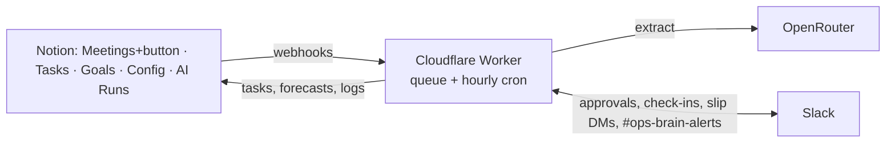

# Ops Brain — Build Plan (PRD 1)

Meetings become *proposed* tasks with owner, date, goal and dependencies. A person approves them. The system then forecasts each chain, checks in before work is late, and warns everyone downstream ≥3 days before a slip reaches them.

## v1 (weeks 1–3) and why

1. **Meeting → Proposed tasks.** A Notion button creates tasks with `Status = Proposed`, owner, goal, `Blocked by`, a source quote and review flags. *(This is the demo.)*
2. **Approval.** Slack DM with *Approve all · Review in Notion*. Nobody is assigned work until a person approves.
3. **Slip forecasting.** latest finish = min(own due, dependents' latest start); latest start = latest finish − Estimate. A task is at risk if it hasn't started by its latest start, its owner says "need more days", or its date moves. Every owner up the chain to the goal gets a DM, with new dates *proposed* (Accept / Keep), never applied.
4. **Check-ins.** Slack, 2 working days before each latest start: *On track? · Need N days · Blocked by…*. No reply gets a nudge, then the lead is told. This catches silent slips.
5. **Priorities.** Goal Weight (1–5) × urgency bucket (late 4 · 1–3 days 3 · 4–7 days 2 · later 1) × (1 + tasks unblocked, max 3). Buckets plus "ties keep yesterday's order" keep ranks stable. Each task gets a why line, e.g. *Launch (5) · starts in 2 days · unblocks 3*. It is a founder-approved formula in config, not AI.
6. **Goal health.** On track / At risk / Off track, with the reason, in Notion.

**Why this order:** everything depends on linked tasks, and extraction is the riskiest part. The demo proves it: free models got 32/33 fields right on 2 held-out notes. Forecasting and check-ins are the PRD's core promise, so they ship in v1. **Later:** founder digest (v2), AI agents for recurring tasks and prompt tuning from run history (v3).

## Architecture

## Data model (added to existing Tasks / Projects / Meetings)

- **Goals:** Weight, Target, Health + reason.
- **Tasks:** Goal · Blocked by ↔ Blocking · Estimate · Latest start · Risk · Score · Why · Last check-in · Quote · Run ID · status `Proposed`.
- **Team:** Slack ID, aliases, hours.
- **Config:** versioned prompts, model routes and rules, each Draft or Live.
- **AI Runs:** input hash, raw output, prompt version, model, tokens, cost, and approved / edited / rejected for each task.

## Buy vs build

- **Buy:** Notion (buttons, webhooks; AI Meeting Notes for Hindi/Gujarati/English), a Slack app, OpenRouter (any model, one API), Cloudflare Workers.
- **Build:**
  - Extraction with checks: nothing off the shelf links to *your* goals and tasks.
  - Chain forecasting: Notion's timeline warns no one.
  - The priority formula.
- **Rejected:** Motion/Reclaim (would replace Notion); Zapier/Make (weak for graph walks, priced per task).

## Failures

- **Bad AI output:** schema check, then one retry that shows the model its error. Anything doubtful becomes a review flag, not a guess: unknown or ambiguous owner, impossible date, quote not in the note, a cycle, a dependency due later.
- **Provider errors:** backoff, then a fallback model.
- **Notion writes:** queued (~3 requests/s).
- **Reruns:** keyed on meeting + content hash; a "delete this run's proposals" button undoes a bad run.
- **Alerts:** plain-language messages in **#ops-brain-alerts**, each naming a runbook entry. Messages are held outside working hours unless a slip is under 3 days away.

## Monthly cost

| Item | ₹/month |
|---|---|
| LLM: 40 meetings × 8k/2k tokens on Haiku 5.5 ($0.10/$0.50 per M), plus slip messages. ₹0 on a free model | ~20 |
| Cloudflare Workers Paid ($5 minimum; includes 1M queue ops) | ~430 |
| Notion Plus or above (needed for webhooks), Slack | existing |
| **Total** | **≈ ₹450**, with each run's cost logged in AI Runs |

**Metrics:**
- Fully linked % comes from a Notion formula.
- Slip lead time is alert time vs. downstream due date.
- Approved-without-edits comes from AI Runs.
- Priority fit is a founder's Friday Agree/Disagree.
- Admin time is lead edits per week.

**Assumptions:**
- Goal weights: founders set 1–5 and review them monthly.
- Alerts: Mon–Sat, 10:00–19:00 IST.
- Tasks are written in English.
- The worker reads Meeting Notes through the Notion API's `meeting_notes` block, available since API 2026-03-11. Webhooks carry properties only, so the content is fetched.
